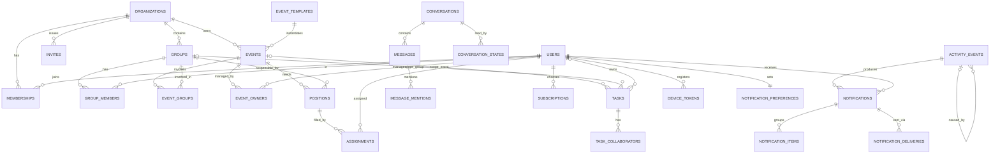

# DATA_MODEL

Phiên bản 0.1 · 2026-11-13 · Phụ thuộc: `PRODUCT_MODEL.md`

Mô hình dữ liệu logic cho một cơ sở dữ liệu quan hệ. Chưa chọn sản phẩm cơ sở dữ liệu cụ thể (OD-13); kiểu dữ liệu ghi ở mức trừu tượng. Tài liệu này không phải mã nguồn.

## 1. Quy ước chung

| Quy ước | Nội dung |
| --- | --- |
| Khoá chính | `id` kiểu UUID sắp xếp được theo thời gian (v7), trừ bảng nối dùng khoá ghép |
| Tenant | Mọi bảng nghiệp vụ có `org_id` (FK → `organizations`), là cột đầu của các chỉ mục truy vấn theo tổ chức |
| Thời gian | `timestamptz` UTC. Múi giờ hiển thị lấy từ `organizations.timezone` hoặc người dùng |
| Đồng thời | Bảng có cột `version` (số nguyên, tăng mỗi lần ghi) dùng khoá lạc quan (AD-13) |
| Tham chiếu đa hình | Cặp `(x_type, x_id)`; `x_type` thuộc sổ đăng ký trong `PRODUCT_MODEL.md` §3.8. Không có FK vật lý; toàn vẹn do tầng ứng dụng bảo đảm và do đối tượng công việc không bao giờ bị xoá cứng (AD-04) |
| Enum | Lưu dạng chuỗi có ràng buộc CHECK |
| Nhãn phạm vi | `[MVP]`, `[S]`, `[EXT]` |

## 2. Entity Relationship Diagram

Quan hệ đa hình không vẽ được bằng FK: `CONVERSATIONS → anchor (group | event | task)`, `LINKS → from/to`, `ATTACHMENTS → owner (message | event | task)`, `SUBSCRIPTIONS → target (event | task | conversation)`, `ACTIVITY_EVENTS → object`, `NOTIFICATIONS → object`.

## 3. Định nghĩa bảng `[MVP]`

Ký hiệu cột: `tên : kiểu` · `?` = cho phép null · `→` = FK.

### 3.1 Danh tính và tổ chức

**`users`**

| Cột | Ghi chú |
| --- | --- |
| `id : uuid` PK | |
| `display_name : text` | |
| `auth_subject : text` UNIQUE | Định danh từ nhà cung cấp đăng nhập (OD-08) |
| `phone : text?`, `email : text?` | UNIQUE từng cột khi không null |
| `contact_visibility : enum(org, managers, hidden)` | Mặc định `managers` |
| `timezone : text?`, `locale : text` | |
| `created_at`, `anonymized_at?` | |

**`organizations`**

| Cột | Ghi chú |
| --- | --- |
| `id` PK, `name : text`, `timezone : text` | |
| `default_event_visibility : enum(org, groups)` | Mặc định `org` (OD-06) |
| `reconfirm_threshold_min : int` | Mặc định 30 (OD-02) |
| `created_at`, `deleted_at?`, `version` | |

**`memberships`** · PK `(org_id, user_id)`

| Cột | Ghi chú |
| --- | --- |
| `org_id →`, `user_id →` | |
| `role : enum(owner, admin, member)` | |
| `status : enum(active, removed)` | |
| `joined_at`, `removed_at?`, `removed_by →users?` | |

Chỉ mục: `(user_id, status)`. Ràng buộc nghiệp vụ: luôn còn ít nhất một `owner` `active`.

**`invites`**

| Cột | Ghi chú |
| --- | --- |
| `id` PK, `org_id →` | |
| `token_hash : text` UNIQUE | Không lưu token gốc |
| `role : enum(admin, member)`, `group_id →groups?` | Nhóm được thêm vào khi nhận lời mời |
| `max_uses : int?`, `used_count : int`, `expires_at`, `revoked_at?` | |
| `created_by →users`, `created_at` | |

### 3.2 Nhóm

**`groups`**

| Cột | Ghi chú |
| --- | --- |
| `id` PK, `org_id →`, `name : text`, `description : text?` | |
| `name_norm : text` | Bản chuẩn hoá để lọc/tìm |
| `created_by →users`, `created_at`, `archived_at?`, `version` | |

UNIQUE `(org_id, name)` với nhóm chưa lưu trữ.

**`group_members`** · PK `(group_id, user_id)`

| Cột | Ghi chú |
| --- | --- |
| `group_id →`, `user_id →`, `org_id →` | |
| `role : enum(leader, member)`, `added_by →users`, `added_at` | |

Chỉ mục: `(user_id)`.

### 3.3 Lịch và phân công

**`events`**

| Cột | Ghi chú |
| --- | --- |
| `id` PK, `org_id →` | |
| `title : text`, `title_norm : text`, `description : text?`, `location : text?` | |
| `starts_at`, `ends_at` | CHECK `ends_at > starts_at` |
| `status : enum(draft, published, cancelled)` | |
| `visibility : enum(org, groups)` | |
| `template_id →event_templates?` | |
| `created_by →users`, `published_at?`, `cancelled_at?`, `cancel_reason : text?` | |
| `created_at`, `updated_at`, `version` | |

Chỉ mục: `(org_id, status, starts_at)`.

**`event_groups`** · PK `(event_id, group_id)` · cột thêm `org_id`. Chỉ mục: `(group_id, event_id)`.

**`event_owners`** · PK `(event_id, user_id)` · cột thêm `org_id`, `added_by`, `added_at`. Chỉ mục: `(user_id)`.

**`positions`**

| Cột | Ghi chú |
| --- | --- |
| `id` PK, `org_id →`, `event_id →` | |
| `name : text` | |
| `group_id →groups?` | Nhóm chịu trách nhiệm lấp vị trí |
| `slots : int` | CHECK `≥ 1`, mặc định 1 |
| `report_offset_min : int` | Giờ có mặt = `events.starts_at + offset`; âm = trước giờ bắt đầu; mặc định 0 |
| `sort : int`, `removed_at?`, `version` | |

Chỉ mục: `(event_id, sort)`.

**`assignments`**

| Cột | Ghi chú |
| --- | --- |
| `id` PK, `org_id →`, `event_id →`, `position_id →`, `user_id →` | `event_id` lặp lại để truy vấn nhanh |
| `status : enum(draft, requested, accepted, declined, reconfirm, cancelled)` | |
| `cancel_reason : enum(removed, replaced, event_cancelled, position_removed, member_left)?` | Bắt buộc khi `cancelled` |
| `decline_reason : text?` | Bắt buộc khi `declined` |
| `requested_by →users?`, `requested_at?` | |
| `responded_at?`, `responded_by →users?` | `responded_by ≠ user_id` = trả lời hộ |
| `replaces_assignment_id →assignments?` | |
| `created_at`, `updated_at`, `version` | |

- UNIQUE một phần: `(position_id, user_id)` với `status ∈ {draft, requested, accepted, reconfirm}`.
- Chỉ mục: `(user_id, status)`; `(event_id, status)`; `(position_id, status)`.
- Bất biến (kiểm tra trong giao dịch, có khoá dòng Position): số Assignment đang hiệu lực của một Position ≤ `slots` (OD-15).

**Kế hoạch nhiều cấp (AD-32; migration `0010_planning`, lộ trình P2–P5 trong `docs/design/lich-nhieu-cap.md`)**

| Bảng / cột | Ghi chú |
| --- | --- |
| `plan_periods`: `id`, `org_id →`, `name`, `starts_on : date`, `ends_on : date`, `kind : enum(period, special_day)`, `color`, `note?`, `created_by`, `archived_at?`, `version` | Giai đoạn; có thể chồng nhau; ngày đặc biệt là giai đoạn một ngày |
| `event_series`: `id`, `org_id →`, `name`, `rule : jsonb`, `local_time : time`, `starts_on`, `until_on?`, `location?`, `definition : jsonb`, `template_id →event_templates?`, `created_by`, `archived_at?`, `version` | `rule` chỉ ba dạng: mỗi n tuần theo thứ; thứ n (hoặc cuối) của tháng; ngày cố định trong năm. Giờ địa phương theo `organizations.timezone`. `definition` cùng dạng `event_templates.definition` (thời lượng, nhóm, vị trí, việc), chụp lại lúc tạo nhịp (IN-54); nhóm của nhịp = `definition.groupIds` |
| `series_variants`: `id`, `org_id →`, `series_id →`, `selector : jsonb`, `action : jsonb`, `created_by`, `created_at` | selector: `date` / `nth` (1..5, -1 = cuối) / `period`; action: `skip` / `keep` (đã xem chỗ trùng, giữ cả hai) / `override` (tên, giờ, định nghĩa). Cùng độ cụ thể thì biến thể tạo sau thắng; mỗi ngày cụ thể giữ một biến thể |
| `events` thêm `series_id →event_series?`, `occurrence_on : date?`, `detached_at?` | UNIQUE `(series_id, occurrence_on)`; `detached_at` = đã sửa riêng, không đổi theo Nhịp |

**`event_templates`**

| Cột | Ghi chú |
| --- | --- |
| `id` PK, `org_id →`, `name : text` | |
| `definition : json` | Thời lượng, `event_groups`, danh sách Position (tên, nhóm, `slots`, offset), danh sách Task mẫu (tiêu đề, `due_offset_min`) |
| `created_by →users`, `created_at`, `archived_at?`, `version` | |

### 3.4 Việc

**`tasks`**

| Cột | Ghi chú |
| --- | --- |
| `id` PK, `org_id →` | |
| `scope_type : enum(event, group, private)` | |
| `event_id →events?`, `group_id →groups?` | CHECK: `event` ⇒ chỉ `event_id`; `group` ⇒ chỉ `group_id`; `private` ⇒ cả hai null |
| `title : text`, `title_norm : text`, `description : text?` | |
| `owner_id →users?`, `assigned_by →users?`, `created_by →users` | |
| `requires_acceptance : bool` | |
| `acceptance : enum(none, pending, accepted, declined)` | |
| `status : enum(open, in_progress, done, cancelled)` | |
| `blocked : bool`, `needs_help : bool` | |
| `due_at?`, `due_offset_min : int?` | CHECK: `due_offset_min` chỉ khi `scope_type = event` |
| `completed_at?`, `completed_by →users?`, `cancelled_at?` | |
| `created_at`, `updated_at`, `version` | |

Chỉ mục: `(owner_id, status)`; `(event_id)`; `(group_id, status)`; `(assigned_by, acceptance)`; `(org_id, due_at)` với `status ∈ {open, in_progress}`.

Nguồn gốc từ tin nhắn không lưu ở bảng này mà ở `links` (`created_from`), để tránh hai nơi cùng một sự thật.

**`task_collaborators`** · PK `(task_id, user_id)` · cột thêm `org_id`, `added_by`, `added_at`. Chỉ mục: `(user_id)`.

### 3.5 Hội thoại

**`conversations`**

| Cột | Ghi chú |
| --- | --- |
| `id` PK, `org_id →` | |
| `anchor_type : enum(group, event, task)`, `anchor_id : uuid` | |
| `last_seq : bigint`, `last_message_at?` | |
| `read_only : bool` | Bật khi anchor bị huỷ/lưu trữ |
| `created_at` | |

UNIQUE `(anchor_type, anchor_id)`. Chỉ mục: `(org_id, last_message_at)`.

**`messages`**

| Cột | Ghi chú |
| --- | --- |
| `id` PK, `org_id →`, `conversation_id →` | |
| `seq : bigint` | Tăng dần trong Conversation, cấp bởi máy chủ |
| `kind : enum(user, system)` | |
| `sender_id →users?` | Null với `system` |
| `body : text?`, `body_norm : text?` | Null sau khi xoá |
| `reply_to_id →messages?` | Cùng Conversation |
| `activity_event_id →activity_events?` | Bắt buộc với `system` |
| `client_msg_id : text?` | Khoá idempotent do client sinh |
| `created_at`, `edited_at?`, `deleted_at?`, `deleted_by →users?` | |

- UNIQUE `(conversation_id, seq)`.
- UNIQUE `(conversation_id, sender_id, client_msg_id)` khi `client_msg_id` không null.
- UNIQUE `(conversation_id, activity_event_id)` khi không null (một sự kiện chiếu một lần vào một hội thoại).

**`message_mentions`** · PK `(message_id, user_id)` · cột thêm `org_id`, `conversation_id`. Chỉ mục: `(user_id, message_id)`.

**`conversation_states`** · PK `(conversation_id, user_id)`

| Cột | Ghi chú |
| --- | --- |
| `last_read_seq : bigint`, `last_pushed_seq : bigint` | |
| `updated_at` | |

Dòng được tạo khi người dùng mở hoặc gửi tin trong hội thoại, hoặc khi họ có lý do trách nhiệm trên anchor. Tab Chat liệt kê: hội thoại của các Group người dùng là thành viên, cộng mọi hội thoại có dòng `conversation_states` của họ mà họ còn quyền đọc. Chỉ mục: `(user_id, updated_at)`.

**`attachments`**

| Cột | Ghi chú |
| --- | --- |
| `id` PK, `org_id →` | |
| `owner_type : enum(message, event, task)`, `owner_id : uuid` | |
| `storage_key : text`, `filename : text`, `mime : text`, `size_bytes : bigint` | |
| `uploaded_by →users`, `created_at`, `removed_at?` | |

Chỉ mục: `(owner_type, owner_id)`.

### 3.6 Ngữ cảnh, theo dõi, lịch sử

**`links`**

| Cột | Ghi chú |
| --- | --- |
| `id` PK, `org_id →` | |
| `from_type`, `from_id`, `to_type`, `to_id` | |
| `relation : enum(references, created_from, resolution, blocks)` | Hai giá trị sau là `[S]` |
| `origin : enum(system, manual)` | |
| `created_by →users?`, `created_at`, `deleted_at?`, `deleted_by →users?` | |

- UNIQUE một phần `(from_type, from_id, to_type, to_id, relation)` khi `deleted_at` null.
- Chỉ mục: `(from_type, from_id)` và `(to_type, to_id)`, cả hai lọc `deleted_at` null. Đây là điều kiện để truy xuất hai chiều.
- CHECK cặp kiểu hợp lệ theo `CONTEXT_ENGINE.md` §2.2.

**`subscriptions`** · PK `(user_id, target_type, target_id)`

| Cột | Ghi chú |
| --- | --- |
| `org_id →`, `target_type : enum(event, task, conversation)`, `target_id` | |
| `mode : enum(follow, mute, all, mentions)` | CHECK: `event`/`task` ⇒ `follow`/`mute`; `conversation` ⇒ `all`/`mentions`/`mute` |
| `created_by →users`, `created_at` | |

Chỉ mục: `(target_type, target_id, mode)`.

**`activity_events`** (append-only)

| Cột | Ghi chú |
| --- | --- |
| `id` PK | |
| `seq : bigint` UNIQUE | Thứ tự toàn cục, dùng cho outbox |
| `org_id →` | |
| `verb : text` | Thuộc danh mục trong `EVENT_API_CONTRACTS.md` §2 |
| `actor_type : enum(user, system)`, `actor_id →users?` | |
| `object_type`, `object_id` | Đối tượng chính |
| `event_id?`, `task_id?`, `group_id?`, `conversation_id?` | Cột ngữ cảnh, điền khi ghi |
| `cause_id →activity_events?` | Luôn trỏ thẳng về sự kiện gốc |
| `payload : json` | Theo contract của verb; có `before`/`after` cho trường thay đổi |
| `request_id : text?` | Khoá idempotent của lệnh sinh ra nó |
| `occurred_at`, `dispatched_at?` | `dispatched_at` null = chưa xử lý |

Chỉ mục: `(object_type, object_id, occurred_at)`; `(event_id, occurred_at)`, `(task_id, occurred_at)`, `(group_id, occurred_at)` (mỗi cái lọc not null); `(cause_id)`; `(seq)` lọc `dispatched_at` null; `(org_id, actor_id, occurred_at)`.

Không có lệnh UPDATE/DELETE nghiệp vụ nào trên bảng này ngoài: đặt `dispatched_at`; xoá theo chính sách lưu giữ (§5); và xoá các dòng của một bản nháp Event chưa từng publish khi bản nháp đó bị xoá.

### 3.7 Thông báo

**`notifications`**

| Cột | Ghi chú |
| --- | --- |
| `id` PK, `org_id →`, `user_id →` | |
| `root_activity_id →activity_events` | Khoá khử trùng |
| `class : enum(action_required, direct)` | |
| `family : text?` | Dùng cho gộp theo thời gian |
| `object_type`, `object_id` | Đối tượng mở ra khi chạm |
| `reasons : text[]` | Lý do audience đã gộp |
| `action_state : enum(none, pending, done, superseded)` | |
| `read_at?`, `action_resolved_at?` | |
| `created_at`, `updated_at` | |

- UNIQUE `(user_id, root_activity_id)`.
- Chỉ mục: `(user_id, created_at)`; `(user_id)` lọc `read_at` null; `(user_id)` lọc `action_state = pending`.

**`notification_items`** · PK `(notification_id, activity_event_id)`

| Cột | Ghi chú |
| --- | --- |
| `notification_id →`, `activity_event_id →activity_events` | |
| `verb : text`, `object_type`, `object_id` | Không chứa nội dung |
| `needs_action : bool`, `resolved_at?` | Mục cần hành động và thời điểm được giải quyết/thay thế |

Chỉ mục: `(object_type, object_id)` lọc `needs_action` và `resolved_at` null (để giải quyết hàng loạt theo đối tượng).

**`notification_deliveries`**

| Cột | Ghi chú |
| --- | --- |
| `id` PK, `notification_id →`, `device_token_id →device_tokens` | |
| `channel : enum(push)` | Mở rộng được |
| `status : enum(scheduled, sent, failed, cancelled, skipped)` | |
| `not_before`, `attempts : int`, `last_error : text?`, `sent_at?` | |

UNIQUE `(notification_id, device_token_id)`. Chỉ mục: `(status, not_before)`.

**`notification_preferences`** · PK `user_id`

| Cột | Ghi chú |
| --- | --- |
| `push_action_required : bool`, `push_direct : bool` | Mặc định `true` |
| `quiet_hours_enabled : bool`, `quiet_start : time`, `quiet_end : time` | Mặc định theo OD-03 |
| `updated_at` | |

**`device_tokens`**

| Cột | Ghi chú |
| --- | --- |
| `id` PK, `user_id →`, `platform : text`, `token : text` UNIQUE | |
| `last_seen_at`, `disabled_at?` | |

## 4. Entity mở rộng

| Bảng | Nhãn | Mục đích | Ghi chú thiết kế |
| --- | --- | --- | --- |
| `scheduled_jobs` | `[S]` | Nhắc việc, leo thang, quá hạn, tóm tắt | `id`, `kind`, `run_at`, `object_type`, `object_id`, `payload`, `status`, `dedupe_key` UNIQUE |
| `unavailabilities` | `[S]` | Ngày bận của thành viên | `id`, `org_id`, `user_id`, `starts_on`, `ends_on`, `reason?` (chỉ người quản lý thấy) |
| `event_items` | `[S]` | Dòng chương trình của Event | `id`, `org_id`, `event_id`, `sort`, `kind`, `title`, `duration_min?`, `notes?`, `external_refs : json`; thêm cột `events.plan_version : int` |
| `integration_clients`, `access_grants` | `[EXT]` | Ứng dụng ngoài truy cập qua API (Koinonia) | Xem `KOINONIA_INTEGRATION.md` |
| `conversation_members` | `[EXT]` | Hội thoại không anchor (DM, nhóm tự do) | Kèm `anchor_type = direct` |
| `conversation_topics` | `[EXT]` | Chủ đề trong hội thoại nhóm lớn | |
| `event_times` | `[EXT]` | Nhiều mốc giờ trong một Event | Thay `report_offset_min` |
| `projects` | `[EXT]` | Vật chứa ngang cấp Event | |
| `digest` trong `notification_preferences` | `[S]` | Tóm tắt | Thêm cột `digest`, `digest_time` |

Không có bảng `decisions`, `documents`, `workflows`, `context_graph` trong thiết kế hiện tại.

## 5. Xoá mềm và lưu giữ

| Đối tượng | Cách "xoá" | Lưu giữ |
| --- | --- | --- |
| Organization | `deleted_at`; xoá cứng toàn bộ dữ liệu sau thời gian chờ | OD-07 |
| Membership | `status = removed`; dòng giữ lại | Vô thời hạn |
| Group | `archived_at`; hội thoại chuyển chỉ-đọc | Vô thời hạn |
| Event `draft` | Xoá cứng được (chưa ai được báo); xoá theo Position, Assignment `draft`, và ActivityEvent của riêng nó | — |
| Event đã publish | Không xoá; chỉ `cancelled` | Vô thời hạn |
| Position | `removed_at` | Vô thời hạn |
| Assignment | Không xoá; `cancelled` | Vô thời hạn |
| Task | Không xoá; `cancelled` | Vô thời hạn |
| Message | `deleted_at`; `body` và `body_norm` đặt null ngay; tệp đính kèm bị gỡ | Dòng giữ vô thời hạn; nội dung không khôi phục được |
| Attachment | `removed_at`; tệp vật lý xoá sau thời gian chờ | OD-07 |
| Link | `deleted_at` | Vô thời hạn |
| ActivityEvent (công việc) | Không xoá | OD-07 |
| ActivityEvent (`message.*`) | Xoá theo hạn | 30 ngày (đề xuất) |
| Notification | Xoá theo hạn | 180 ngày (đề xuất) |
| NotificationDelivery | Xoá theo hạn | 30 ngày (đề xuất) |
| User | `anonymized_at`: xoá tên, liên hệ, `auth_subject`; giữ `id` | OD-07 |

Các thời hạn "đề xuất" chưa dựa trên yêu cầu pháp lý nào đã kiểm chứng.

## 6. Lịch sử kiểm toán

- Mọi lệnh làm thay đổi dữ liệu nghiệp vụ ghi ít nhất một dòng `activity_events` **trong cùng giao dịch** với thay đổi đó.
- Trường được lưu `before/after`: thời gian, địa điểm, trạng thái, người phụ trách, hạn, vai trò, `visibility`, `slots`.
- Hành động thay mặt người khác luôn có cả `actor_id` và người bị tác động trong payload.
- Không ghi nội dung tin nhắn vào `activity_events`.
- Những thay đổi **không** ghi lịch sử (có chủ ý): trạng thái đã đọc, Subscription, Preference, đăng ký thiết bị.

## 7. Toàn vẹn chéo không biểu diễn được bằng FK

| Bất biến | Nơi bảo đảm |
| --- | --- |
| Mọi `user_id` trong bảng nghiệp vụ có Membership `active` cùng `org_id` tại thời điểm ghi | Lệnh nghiệp vụ |
| Hai đầu của Link, và anchor của Conversation, cùng `org_id` với dòng | Lệnh nghiệp vụ |
| Event đã publish có ≥ 1 `event_owners` | Lệnh gỡ owner / gỡ thành viên |
| Số Assignment đang hiệu lực ≤ `positions.slots` | Giao dịch có khoá dòng Position |
| `assignments.event_id = positions.event_id` | Lệnh tạo Assignment |
| `tasks.due_at = events.starts_at + due_offset_min` khi có offset | Lệnh dời lịch và lệnh sửa Task |
| `messages.reply_to_id` cùng `conversation_id` | Lệnh gửi tin |
| `message_mentions.user_id` có `read(conversation)` | Lệnh gửi tin |

## Phụ lục: Ràng buộc từ ngăn xếp (AD-26, AD-27, AD-29)

- `users.auth_subject` (text, UNIQUE) lưu định danh của Supabase Auth. **Không có FK vật lý** tới schema của nhà cung cấp; ánh xạ do Backend tạo khi đăng nhập lần đầu. Thêm phương thức đăng nhập sau (số điện thoại + OTP) là thêm cách xác định `auth_subject`, không đổi `users`. `[EXT]`: bảng `user_identities` nếu một người cần nhiều nhà cung cấp.
- Kiểu vật lý: khoá `uuid` (UUIDv7 sinh ở Backend), thời gian `timestamptz`, trạng thái `text` + ràng buộc `CHECK` (không dùng kiểu ENUM của Postgres, vì khó thêm giá trị bằng migration an toàn), tham chiếu đa hình `(type text, id uuid)`.
- Migration là tệp SQL có phiên bản trong kho mã, chạy tuần tự có kiểm soát. Không sửa schema bằng bảng điều khiển.
- Đối tượng đặc thù Supabase (chính sách RLS trên `realtime.messages`, `storage.objects`) nằm trong thư mục migration riêng `supabase_specific/`, để thấy rõ phạm vi phụ thuộc.
- Tệp đính kèm: nội dung lưu ở Storage; bảng `attachments` giữ khoá đối tượng và siêu dữ liệu. Quyền tải xuống vẫn qua `can()` của Backend (URL ký ngắn hạn do Backend cấp), không dựa riêng vào chính sách Storage.
- `device_tokens` đổi thành `push_subscriptions` (endpoint + khoá Web Push, `user_id`, `last_seen_at`, `platform`, `installed_standalone`).
